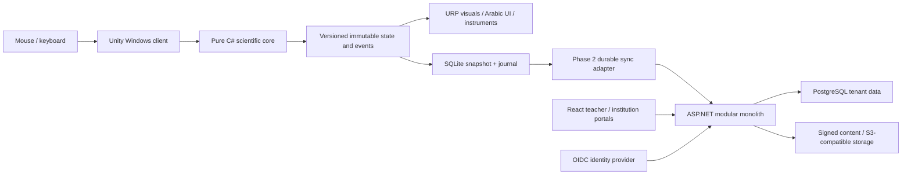

# Software architecture — proposed baseline

## Boundaries

One authoritative scientific layer; it imports no Unity, HTTP, database or portal dependencies. Shared contracts target .NET Standard 2.1 with C# 9 for Unity compatibility. Server uses a separate .NET 10 target. Desktop commands validate identifiers, finite numbers, units, capacities and expected revision before a deterministic transition. Only successful state transitions generate render events. Rendering may interpolate without changing state. UI measurement refresh is bounded; solve on state change for the initial static models rather than inventing a required 50 Hz solver.

Desktop modules: interaction, experiment orchestration, scientific core, presentation/localization, persistence, content catalog; Phase 2 adds identity, licensing and synchronization adapters. Ports include `IScientificSolver`, snapshot repository, event journal, content verifier and clock. A rejected command preserves state and returns a typed reason; exceptions are not educational results.

Server modular monolith boundaries: Tenancy/Identity, Classroom, Content, Attempts/Assessment, Licensing, Commercial Records, Integrations, Audit. Use internal interfaces and a single deployable API/PostgreSQL store initially. No public server endpoints that accept a client-provided final grade as authoritative. Separate web portal from Unity; do not embed the teacher portal in the simulator.

## Trust and security design

OIDC authorization-code login with PKCE through the system browser; no client secret in the desktop. Short-lived access tokens, OS-protected refresh credentials, explicit logout on shared machines. Server derives tenant membership from verified identity and checks object/class authorization on every operation. Global identity is distinct from tenant membership. Platform operator access to learner data is separately approved, time bounded and audited.

PostgreSQL composite tenant foreign keys plus application checks and row policies form separate layers. Runtime role must not own tables or bypass RLS; set tenant context inside each transaction to avoid pooled-connection leakage. Auth-provider, RLS and two-tenant integration spikes remain required, not implemented claims.

Local machine is untrusted for high-stakes grades. Store minimal learner identifiers, not cloud administrator credentials. Sensitive local records need a vetted encryption provider and Windows key protection; journal tampering cannot be solved by embedding a shared HMAC key. Server replays/validates supported action sequences with frozen model/rubric versions; teacher overrides require reason and audit. Offline grades are provisional.

Publish separate signing keys for content and licensing; only public verification keys ship to clients. Validate signature, package hash, expiry, schema compatibility and key ID before activation; install atomically and keep last valid version. TLS, signed installers, dependency/asset-license review, backup restore drills and key rotation become measured gates in their implementation phases. Data residency, retention and Saudi privacy obligations require designated review; no compliance certification is claimed.

## Offline ownership and reconciliation

Client owns unsynced draft experiment state; server owns membership, assignments, released content, entitlements and accepted assessments. Commit snapshot and related events in one local transaction. Do not erase acknowledged journal history until retention/export policy permits it. Outbox retries use exponential backoff with jitter; per-event acknowledgement permits safe partial retry. Server uniqueness `(tenant_id,event_id)` prevents duplicate effects. A matching ID with a different payload is rejected and audited. Duplicate retries return the original acknowledgement.

Attempt state revision and contiguous sequence numbers prevent reordering; missing predecessors are retryable, unsupported versions quarantined for explicit recovery. Accepted/finalized attempts are immutable; divergent edits fork a draft or receive an explicit conflict, never last-write-wins on grades. Assignment revocation does not delete local work. Show pending/rejected/conflict states and export a recovery bundle.

Strict global concurrent-seat enforcement is impossible across fully disconnected devices without preallocation. Allocate a bounded offline seat pool to devices, reducing the online pool until allocation expiry. Signed tokens bind tenant, device, allocation, content and expiry. Grace length, clock rollback policy, revocation latency and on-premises coordinator needs remain owner decisions.

## Decision log

| ID | Decision / proposed choice | Verification remaining |
|---|---|---|
| ADR-01 | Unity 6.3 LTS + URP; exact patch pending editor installation | Windows editor import, package lock, empty build |
| ADR-02 | Scientific core .NET Standard 2.1, C# 9; server .NET 10 | Shared-library build and Unity import |
| ADR-03 | Native UI first; embedded browser conditional | Arabic shaping, BiDi, input/focus and license spike |
| ADR-04 | Resistive DC MNA; no SPICE native dependency initially | Scientific reviewer and graph tests |
| ADR-05 | SQLite local / PostgreSQL cloud | Provider/IL2CPP smoke, transactional recovery, RLS tests |
| ADR-06 | Modular monolith; React portals from Phase 2 | Tenant-aware API integration tests |

Version choices were checked against primary sources on 2026-11-01: [Unity LTS support](https://unity.com/releases/unity-6/support), [Unity API compatibility](https://docs.unity.com/en-us/engine/6000.3/manual/programming-environment/overview-of-dot-net-in-unity/dotnet-profile-support), [.NET download](https://dotnet.microsoft.com/en-us/download/dotnet), [Node 24.22.2](https://nodejs.org/en/blog/release/v24.22.2), [React versions](https://react.dev/versions). These references inform proposed tool versions; they do not prove local compatibility. The empty portal now has exact package pins and a lockfile and builds on installed Windows Node 22.17.0; the proposed Node 24.22.2 baseline remains unverified. npm-registry queries selected TypeScript 7.0.2, Vite 8.3.5 and React/types 19.3.0.
